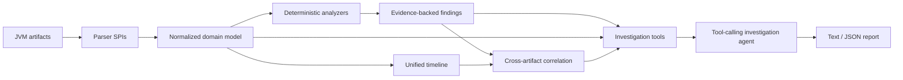

# Helix

**JVM diagnostics through deterministic analysis, cross-artifact correlation, and tool-calling AI.**

Helix ingests JVM diagnostic artifacts, normalizes them into a shared domain model, applies deterministic analyzers, correlates events across artifacts, and produces text or JSON reports. When a user asks a question, an investigation agent queries only the relevant normalized evidence before answering.

Helix is an active engineering project, not a hosted observability service or a replacement for continuous production telemetry. Its current focus is post-incident analysis of thread dumps, GC logs, JFR recordings, heap dumps, and HotSpot crash logs.

| At a glance | Current state |
|---|---|
| Runtime | Java 21, Maven multi-module build |
| Diagnostic inputs | Thread dumps, GC logs, JFR, HPROF, HotSpot crash logs |
| Analysis model | Deterministic findings, evidence reliability, unified timeline, Drools correlation |
| AI integration | Optional Gemini function calling over registered diagnostic tools |
| Interfaces | CLI with text and JSON reports |
| Maturity | Working post-incident analysis platform under active development |

## Why Helix

Most diagnostic tools analyze one artifact at a time. Production incidents rarely fit that boundary: an OOM investigation may require the allocation site from JFR, retained objects from a heap dump, and reclamation behavior from a GC log.

Helix provides one pipeline for that investigation:



The LLM does not parse raw HPROF, JFR, or log files. Parsers and analyzers establish the evidence; the agent retrieves targeted normalized data, tests a causal explanation, and either concludes or reports insufficient evidence.

## Validated OOM investigation

The repository includes a [sanitized report excerpt](examples/reports/oom-investigation.txt) generated from a controlled Java heap-exhaustion scenario using a JFR recording, G1 GC log, and HPROF heap dump.

Helix identified that:

- the JVM recorded an `OutOfMemoryError` at `JVMFaultSimulator.triggerHeapOOM:67`;
- five surviving 10 MiB `byte[]` objects were allocated at that location;
- the main thread was the GC root retaining the local object graph, not itself the leaking object;
- four logical G1 humongous-allocation collections occurred; and
- the final two Full GCs reclaimed 0 MiB, leaving 58 of 64 MiB occupied.

The agent then answered the question **“Why did this JVM run out of memory?”** using heap, JFR, and GC tools. The conclusion was independently checked against the simulator source and raw artifacts.

## Current capabilities

| Artifact | Parsing and normalization | Deterministic analysis |
|---|---|---|
| Thread dumps | HotSpot, OpenJ9, simplified JFR text, multi-snapshot files, partial/truncated input | Deadlocks, lock contention, stuck threads, state distribution, duplicate stacks, thread-pool pressure |
| GC logs | JDK unified logging, JDK 8 legacy logs, OpenJ9 verbose GC fragments, rotated/truncated logs | Pause percentiles, throughput, cause distribution, explicit `System.gc()`, heap gradients, humongous allocations, allocation/promotion rates, ineffective Full GC detection |
| JFR | JDK `RecordingFile`; GC, OOM heap dump, old-object, execution, allocation, monitor, I/O, deoptimization, compiler, virtual-thread, and native-library events | OOM evidence, surviving-object samples, allocation hotspots, CPU flame graphs, lock contention, slow I/O, deoptimizations, virtual-thread pinning |
| HPROF | Eclipse MAT-backed heap queries | Histograms, dominators, retained object graphs, byte-array retention, classloader suspects, duplicate strings, finalizer backlog |
| HotSpot crash logs | Tolerant section-based `hs_err_pid` parsing | Crash classification, problematic/native frames, stack-corruption clues, native-library ownership, environment findings |

Additional platform capabilities include:

- normalized findings with `FACT`, `DERIVED`, and `HEURISTIC` reliability;
- a unified timeline across heterogeneous artifacts;
- embedded Drools correlation rules with a deterministic Java fallback;
- evidence references and tool traces in generated reports;
- severity filtering and time-window filtering;
- `ServiceLoader`-based parser, analyzer, correlator, reporter, reasoning, and investigation-model extension points; and
- a Maven reactor with automated verification across the implemented modules.

## Engineering highlights

- **Format-independent analysis:** artifact-specific parsers feed shared domain records, so analyzers are not coupled to log text or vendor APIs.
- **Evidence before explanation:** deterministic findings carry reliability and evidence references before an LLM participates.
- **Bounded agent behavior:** the investigation model can call only registered, typed diagnostic tools and must return sufficient evidence or explicitly stop.
- **Fault-tolerant ingestion:** truncated and partial diagnostic artifacts produce warnings and partial results instead of invalidating the complete investigation.
- **Deterministic fallback:** cross-artifact rules continue through a Java implementation if the embedded Drools rule set cannot load.
- **Auditable output:** reports include the final conclusion, finding reliability, supporting evidence, and tool traces.

## Evidence-first investigation agent

Supplying `--question` activates a bounded tool-calling investigation. The current Gemini-backed model can use:

- `list_artifacts`
- `search_findings`
- `query_threads`
- `query_jfr`
- `query_gc`
- `query_heap`

For causal memory questions, the orchestrator requires non-empty heap, JFR, and GC evidence when those artifacts are available. A successful but empty query does not satisfy the policy. The agent is also instructed to distinguish allocation sites, retained objects, GC roots, and collector behavior rather than treating temporal proximity as proof of causation.

This is deliberately not an autonomous production-remediation agent. It cannot run arbitrary shell commands, mutate a JVM, deploy changes, or invent tools outside the registered diagnostic surface.

## Requirements

- JDK 21
- Maven 3.9+
- Eclipse Memory Analyzer (MAT) for real HPROF analysis
- A Gemini API key only when using LLM reasoning or `--question`

Thread dumps, GC logs, JFR recordings, and crash logs do not require external parsing tools.

## Build and verify

```bash
mvn verify
```

Build the executable CLI:

```bash
mvn -pl helix-cli -am package
java -jar helix-cli/target/helix-cli-0.1.0-SNAPSHOT.jar version
```

## CLI usage

Analyze one artifact:

```bash
java -jar helix-cli/target/helix-cli-0.1.0-SNAPSHOT.jar \
  --output text \
  analyze path/to/thread-dump.txt
```

Correlate multiple artifacts:

```bash
java -jar helix-cli/target/helix-cli-0.1.0-SNAPSHOT.jar \
  --output json \
  --output-dir ./helix-reports \
  analyze --correlate \
  path/to/recording.jfr \
  path/to/gc.log \
  path/to/heap.hprof
```

Ask an evidence-backed question:

```bash
export GEMINI_API_KEY="your-api-key"
export GEMINI_MODEL="gemini-2.5-flash" # optional; this is the current default
export HELIX_MAT_HOME="/path/to/MemoryAnalyzer"

java -jar helix-cli/target/helix-cli-0.1.0-SNAPSHOT.jar \
  --output text \
  --output-dir ./helix-reports \
  analyze --correlate \
  --question "Why did this JVM run out of memory?" \
  path/to/recording.jfr \
  path/to/gc.log \
  path/to/heap.hprof
```

Reports are written to `./helix-reports/` by default. Use `--no-llm` for deterministic analysis without LLM-generated reasoning.

Useful analysis options:

```text
--type heap|thread|gclog|jfr|crash
--since <ISO-8601 instant>
--until <ISO-8601 instant>
--threshold CRITICAL|HIGH|MEDIUM|LOW
--framework spark|spring|netty
--correlate
--question <question>
```

## Eclipse MAT configuration

Helix uses Eclipse MAT's headless runtime for HPROF queries because MAT is distributed as an Eclipse application rather than ordinary Maven dependencies.

Install the standalone Memory Analyzer application and point `HELIX_MAT_HOME` to the installation directory or its `plugins/` directory:

```bash
export HELIX_MAT_HOME="/path/to/MemoryAnalyzer.app/Contents/Eclipse"

java -jar helix-cli/target/helix-cli-0.1.0-SNAPSHOT.jar \
  --output text \
  analyze path/to/heap.hprof
```

Helix verifies that the MAT API, parser, and HPROF bundles are present before starting heap analysis.

## Architecture

The main implemented modules are:

```text
helix-core                         Shared models and SPIs
helix-parsers/                     Artifact-specific parsers
helix-analyzers/                   Deterministic diagnostic analyzers
helix-correlation                  Timeline correlation and Drools rules
helix-agent-core                   Tool registry and investigation orchestration
helix-agent-{memory,gc,jfr,...}    Domain reasoning agents
helix-reasoning                    Gemini reasoning and function-calling adapter
helix-reporters/                   Text and JSON report implementations
helix-cli                          Executable command-line application
```

Parsers depend on artifact formats, while analyzers depend only on normalized records in `helix-core`. This separation allows another parser implementation to feed the same analysis rules and keeps deterministic logic testable without large binary fixtures.

See [DECISIONS.md](DECISIONS.md) for architectural decisions and implementation trade-offs.

## Current limitations

- Helix is currently a post-incident CLI, not a continuously running metrics backend.
- HPROF analysis requires a local Eclipse MAT installation.
- Gemini is the only implemented tool-calling model adapter.
- Small-object leaks, native/direct-memory exhaustion, metaspace exhaustion, thread-creation failures, and container-level OOMKills need broader evidence policies.
- Live attach, Kubernetes collection, HTML reporting, the web UI, framework plugins, MCP exposure, semantic retrieval, and knowledge-graph features are scaffolded or planned rather than production-ready.
- LLM conclusions remain probabilistic; deterministic findings and tool traces are the source of truth.

## Roadmap

The roadmap is intentionally separated from shipped functionality.

### Next: diagnostic depth and evaluation

1. expanding memory investigations beyond large-object Java heap OOMs;
2. adding source-aware event deduplication and stronger timeline semantics;
3. adding native/direct-memory, metaspace, thread-creation, and container OOM evidence policies;
4. adding an evaluation suite for causal accuracy, unsupported claims, tool selection, and insufficient-evidence behavior; and
5. packaging reproducible diagnostic scenarios for demos and regression tests.

### Product surface

- a web UI for artifact upload, finding drill-down, correlated timelines, evidence inspection, and investigation conversations;
- HTML reports suitable for sharing during incident reviews;
- live JVM attachment and bounded diagnostic capture;
- Kubernetes collection for pod context, restarts, deployments, container limits, and OOMKill correlation;
- framework-aware diagnostics for Spring, Netty, and Spark; and
- persisted investigations for comparison across incidents and deployments.

### AI platform

- an MCP server exposing Helix's typed diagnostic tools to compatible clients;
- additional model-provider adapters behind the existing investigation interface;
- semantic search and RAG over validated historical incidents, runbooks, and prior findings;
- a knowledge graph connecting services, JVMs, deployments, artifacts, findings, and incident hypotheses; and
- specialized multi-agent workflows only after the single-agent investigation path has reliable evaluations and clear coordination boundaries.

### Advanced exploration

- performance anomaly detection over longitudinal JVM telemetry;
- deployment-to-regression and cross-service timeline correlation;
- automated hypothesis ranking with explicit supporting and contradicting evidence; and
- human-approved remediation planning and verification.

RAG, multi-agent workflows, and knowledge graphs will be added only where they improve diagnostic quality over targeted structured queries. Autonomous production changes are not a roadmap goal without explicit human approval and strong safety controls.

## License

Licensed under the [Apache License 2.0](LICENSE).
