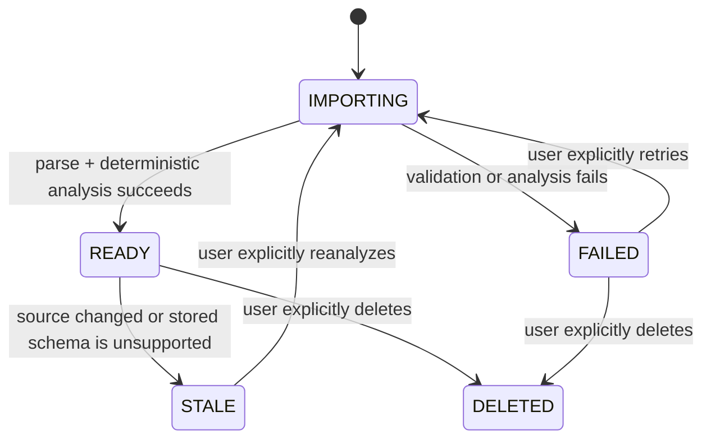
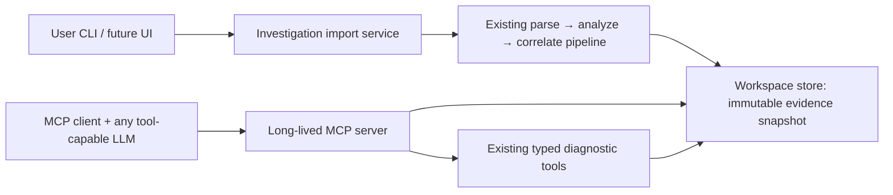

# Feature specification: Persistent investigation workspaces

## Summary

Replace Helix MCP's current single, startup-time artifact set with persistent,
user-created investigations. A user imports an incident once through the Helix
CLI or future UI; Helix parses and analyzes it once, stores a versioned evidence
snapshot, and lets MCP clients query that investigation by ID.

The result is a stable MCP configuration, fast IDE restarts, and a safer boundary
between an LLM and a user's local files.

## Problem

Today, `helix-mcp` receives artifact paths as process arguments. It starts an
STDIO server, analyzes those files in the background, and holds one
`InvestigationContext` in memory. Changing incidents requires editing MCP
settings and restarting the host. Restarting reparses the artifacts, including
potentially expensive HPROF analysis.

That is acceptable for a local proof of concept, but not a good daily workflow:

- IDE configuration becomes incident-specific and easy to misconfigure.
- A restart repeats expensive parsing.
- MCP has no stable investigation identity, history, or lifecycle.
- An LLM cannot safely be given arbitrary filesystem access merely to change its
  evidence set.

## Goals

- Let users import an artifact set once and receive a stable investigation ID.
- Persist the normalized evidence, findings, timeline, correlation output,
  warnings, and analysis metadata needed for read-only investigation.
- Let a long-lived MCP server query any ready investigation in a configured
  workspace without editing settings for each incident.
- Make IDE restarts reuse ready evidence without reparsing unchanged artifacts.
- Keep artifact import under explicit user control; an LLM must not choose an
  arbitrary local path or upload arbitrary files.
- Preserve evidence-first reasoning: MCP tools return bounded, structured
  evidence and never raw HPROF/JFR/log content by default.
- Work offline and retain Helix's no-telemetry posture.

## Non-goals

- A hosted multi-tenant observability backend.
- Live JVM attachment, Kubernetes collection, or automatic artifact capture.
- A database, object store, or distributed scheduler in the first release.
- Letting an LLM create, delete, import, or reanalyze investigations.
- Persisting conversational transcripts, model prompts, or API keys.
- Changing deterministic analyzer semantics or making an LLM the source of
  incident facts.

## User experience

### Create an investigation

The user imports artifacts through a deliberate CLI command, not an MCP tool:

```bash
helix investigation create \
  --workspace ~/.helix/workspaces/default \
  --name "checkout-oom-2026-08-23" \
  --correlate \
  /incidents/checkout/gc.log \
  /incidents/checkout/recording.jfr \
  /incidents/checkout/heap.hprof
```

Helix reports progress, validates the artifacts, parses and analyzes them, then
prints an ID such as `inv_01J...`. The command exits successfully only when the
investigation is `READY`; failures retain an inspectable `FAILED` record.

The CLI also supports:

```bash
helix investigation list --workspace ~/.helix/workspaces/default
helix investigation show inv_01J... --workspace ~/.helix/workspaces/default
helix investigation delete inv_01J... --workspace ~/.helix/workspaces/default
```

`delete` removes only Helix-owned stored evidence and metadata. It never deletes
the user's source artifact files.

### Configure MCP once

The MCP client configuration is stable and contains only the workspace location:

```json
{
  "mcpServers": {
    "helix": {
      "command": "java",
      "args": [
        "-jar",
        "/absolute/path/to/helix-mcp.jar",
        "--workspace",
        "/Users/alex/.helix/workspaces/default"
      ]
    }
  }
}
```

Restarting the IDE restarts the STDIO server but does not reparse ready
investigations. The server loads their stored evidence snapshots on demand.

### Ask questions

The model first calls `list_investigations`, then supplies an
`investigationId` on each evidence query. For example:

```text
User: Why did checkout run out of memory?
Model: list_investigations()
Model: query_heap(investigationId="inv_01J...", operation="BYTE_ARRAYS")
Model: query_jfr(investigationId="inv_01J...", eventType="jdk.ObjectAllocationSample", ...)
Model: query_gc(investigationId="inv_01J...", operation="SUMMARY")
```

The client can display the investigation name, status, artifacts, parser
warnings, evidence provenance, and report generation time before reasoning.

## Product behavior

### Investigation lifecycle



States:

| State | Meaning | MCP behavior |
|---|---|---|
| `IMPORTING` | CLI/UI is parsing or analyzing a user-selected artifact set. | Listed with progress; evidence queries return `UNAVAILABLE`. |
| `READY` | A complete immutable evidence snapshot is available. | Queryable. |
| `FAILED` | Import could not complete. Failure details are available to the user. | Listed; evidence queries return a safe failure summary. |
| `STALE` | Stored evidence no longer matches the source fingerprint or stored schema. | Not used for causal conclusions; user must explicitly reanalyze. |
| `DELETED` | Helix-owned data has been removed. | Not listed or queryable. |

An investigation is immutable once `READY`. Reanalysis creates a new revision
under the same logical investigation, or a new investigation when the user asks
for a clean comparison. Do not silently replace evidence used in a prior answer.

### Artifact ownership and reproducibility

The default import mode is **reference, do not copy**:

- Helix stores a normalized source path, size, modification time, and content
  fingerprint where practical.
- Helix stores the evidence snapshot required for future queries; it does not
  duplicate a multi-gigabyte HPROF/JFR by default.
- The user may select an explicit `--copy-artifacts` mode when they need a
  portable, self-contained investigation bundle and accept the storage cost.

Before reanalysis, Helix validates stored artifact fingerprints. A mismatch marks
the existing investigation `STALE`; it does not silently produce a mixed-evidence
report.

Each evidence snapshot records the Helix version, parser/analyzer versions,
analysis options, correlation setting, import time, artifact metadata, warnings,
and a schema version. This lets users understand whether two investigations are
comparable.

## Architecture



### New core abstractions

Introduce interfaces in `helix-core`; keep file-system storage out of the domain
model and MCP module.

```java
interface InvestigationStore {
  InvestigationSummary create(CreateInvestigationRequest request);
  Optional<StoredInvestigation> find(InvestigationId id);
  Page<InvestigationSummary> list(InvestigationQuery query);
  void delete(InvestigationId id);
}

interface InvestigationImporter {
  InvestigationSummary importArtifacts(CreateInvestigationRequest request);
  InvestigationSummary reanalyze(InvestigationId id);
}
```

`StoredInvestigation` contains a versioned, deserialized evidence snapshot—not a
mutable reference to a live analysis process. The existing `InvestigationContext`
remains the query-time shape; an adapter reconstructs it from stored evidence.

The initial implementation is `LocalWorkspaceInvestigationStore` in a dedicated
module, for example `helix-investigations`. It should use atomic directory
creation/replacement, file locks for write operations, and read-only snapshots
after they become ready. Do not introduce a database before there is a real
multi-user or server deployment requirement.

### Workspace layout

The exact serialization is internal, but a local workspace should be inspectable
and recoverable:

```text
~/.helix/workspaces/default/
  workspace.json
  investigations/
    inv_01J.../
      manifest.json
      evidence.json
      report.json
      import.log
```

`manifest.json` contains lifecycle state and metadata. `evidence.json` contains
only Helix-owned, versioned normalized records needed for tools and reports.
Never store raw source artifact content in `evidence.json`. Partial writes must
remain in an owned temporary directory until the manifest can atomically become
`READY`.

The initial store should cap serialized output, reject unsupported schema
versions clearly, and avoid loading all investigations into memory at server
startup. A selected investigation may be cached with a bounded size/TTL policy.

### MCP tool contract

Add these read-only MCP tools:

| Tool | Purpose |
|---|---|
| `list_investigations` | List ready/importing/failed investigations with ID, name, timestamps, status, artifact types, and warnings count. |
| `get_investigation` | Return one investigation's metadata, lifecycle status, artifact manifest, and analysis version. |

Add a required `investigationId` argument to the existing read-only tools:

- `list_artifacts`
- `search_findings`
- `query_threads`
- `query_jfr`
- `query_gc`
- `query_heap`

Do **not** add a mutable `select_investigation` tool. Carrying the ID on every
call is stateless, concurrency-safe, auditable, and prevents two conversations
from accidentally querying different incidents through one MCP process.

Tool results must include the investigation ID, evidence snapshot/version, and
truncation information. All existing result limits remain bounded. Add pagination
or explicit cursors before increasing result limits.

### Backward compatibility

Keep the current artifact-path launch form during the migration:

```text
java -jar helix-mcp.jar --correlate artifact1 artifact2
```

It creates an ephemeral, in-memory investigation for local demos and exits when
the MCP process exits. Document it as compatibility/demo mode.

The new workspace mode is the recommended mode:

```text
java -jar helix-mcp.jar --workspace /path/to/workspace
```

Do not remove artifact-path mode until the workspace import workflow and MCP
queries have regression coverage and a documented migration path.

## Security and privacy requirements

1. **No LLM-controlled filesystem import.** Artifact paths are accepted only by
   a local user-facing CLI/UI import command. MCP exposes no `open_file`,
   `import_artifacts`, `reanalyze`, or deletion tool.
2. **Workspace confinement.** MCP reads only a user-configured workspace. It
   must not follow IDs, paths, symlinks, or manifest data outside that workspace.
3. **Safe artifact metadata.** Paths, stack traces, filenames, JFR attributes,
   heap strings, findings, and logs are untrusted evidence. They must never be
   interpreted as model instructions.
4. **Least disclosure.** Existing tools return compact, bounded projections. Do
   not return raw artifact bytes, complete heap strings, raw `Finding.rawData`,
   secrets, or environment values by default.
5. **Local ownership.** Workspace files should be user-readable only where the
   operating system supports it. Do not create telemetry or background network
   synchronization.
6. **Explicit destructive action.** Delete/reanalyze is user-initiated from
   CLI/UI and should require the ID to match exactly. Never delete source files.

## Performance and reliability requirements

- A ready investigation must be queryable after an IDE restart without re-running
  artifact parsing or deterministic analysis.
- Import has visible phase progress: validation, parsing per artifact, analysis,
  correlation, persistence, ready/failed.
- HPROF analysis remains isolated as it is today; MAT sidecars must not alter the
  user source directory.
- An interrupted import leaves no queryable partial evidence. It may leave a
  recoverable failed record with safe diagnostics.
- Concurrent MCP reads of different investigations must not share mutable
  context or tool state.
- Corrupted/unsupported evidence snapshots fail closed: return `UNAVAILABLE` or
  a safe error and require explicit reanalysis.

## Acceptance criteria

### CLI and storage

- A user can create, list, inspect, and delete a local investigation without
  editing MCP configuration.
- Creating a ready investigation persists its normalized evidence, findings,
  timeline, warnings, correlation summary, and analysis provenance.
- Restarting the CLI or IDE does not reparse a ready investigation.
- A changed source artifact is detected before explicit reanalysis and marks the
  prior snapshot stale rather than silently changing its evidence.
- Deleting an investigation removes only Helix-owned workspace data.

### MCP

- Workspace mode starts without artifact paths.
- `list_investigations` and `get_investigation` return bounded, structured,
  read-only results.
- Every evidence query requires a valid ready `investigationId`.
- Queries against importing, failed, stale, deleted, or unknown IDs return a
  clear structured status and do not fabricate evidence.
- Two interleaved clients can query different IDs without cross-contamination.
- Existing artifact-path mode remains functional during the migration.

### Safety and quality

- There is no MCP tool accepting arbitrary local artifact paths or deletion
  requests.
- Tests prove workspace confinement and that malformed manifests cannot escape
  the workspace.
- Tests prove interrupted writes do not create `READY` partial snapshots.
- Tests prove no raw HPROF/JFR bytes or full internal `rawData` appear in MCP
  results.
- Existing parser, analyzer, MCP-schema, and investigation-tool tests continue
  to pass.

## Delivery plan

### Phase 1: local persistence foundation

Add versioned investigation metadata, local workspace store, CLI import/list/show,
and tests for lifecycle, atomic writes, source fingerprinting, and deletion.
Persist enough normalized evidence to reconstruct `InvestigationContext`.

### Phase 2: workspace MCP mode

Add `--workspace`, `list_investigations`, `get_investigation`, and the required
ID parameter to evidence tools. Preserve current static-artifact mode. Add
multi-investigation and restart tests.

### Phase 3: evidence and user-experience hardening

Add import progress, actionable failure messages, cache bounds, stale detection,
artifact/source provenance, and a concise user guide. Exercise a real HPROF/JFR
investigation manually with Eclipse MAT configured.

### Deferred work

Only after this is reliable:

- add a web upload/select-investigation flow using the same importer/store;
- add optional, user-controlled portable investigation bundles;
- add a typed `search_knowledge` RAG tool over vetted runbooks and historical
  investigations; and
- add evaluation cases that compare tool use and answers across models.

RAG and multiple agents do not replace the need for a stable investigation
workspace. This feature is the durable evidence boundary they should build on.

## Design decisions and tradeoffs

- **Workspace store before database:** it delivers the correct single-user MCP
  workflow with much less operational complexity. Introduce a database only for
  a real concurrent/server product requirement.
- **Explicit import instead of LLM path selection:** slightly more user effort,
  but it prevents a model from browsing arbitrary local files and makes incident
  scope auditable.
- **Investigation ID on every tool call instead of mutable selection:** more
  verbose tool schemas, but no session ambiguity, accidental cross-incident
  answers, or shared mutable state.
- **Persist normalized evidence, not raw dumps by default:** enables fast
  restarts without duplicating large/sensitive artifacts. Reanalysis remains
  possible when sources are intentionally retained or copied.
- **Immutable ready snapshots:** answers can cite a stable evidence version;
  users can compare revisions without silently changing history.
